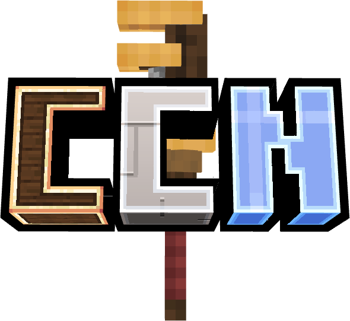

# Create Craft modpack

> Build massive machines, automate everything, and play together on a Create-focused Minecraft server.

## What is Create Craft?

**Create Craft** is a Minecraft modpack and community server built around the [Create](https://modrinth.com/mod/create) and Create [aeronautics](https://modrinth.com/mod/create-aeronautics/versions) mods. Instead of just mining and crafting, you design working contraptions: gears, belts, trains, drills, farms, and factories that run on rotational power.

Whether you like tidy factory lines, ambitious train networks, or giant moving machines, Create Craft gives you the tools and a friendly community to build them with.

## Features

- **Create-focused gameplay**: automation, logistics, airships and engineering are the heart of the pack
- **Multiplayer server**: build alongside friends, trade, and show off your creations
- **Curated mod list**: long list of addons that complement Create
- **Active community**: help, ideas, and events on our Discord

## Join the server

1. Install the modpack (see the website or discord for the latest version and instructions)
2. Launch the game and add the server address from our website
3. Join the Discord for announcements, support, and to meet other players

## Links

| | |
|---|---|
| 🌐 **Website** | [createcraft.store](https://createcraft.store) |
| 💬 **Discord** | [Join our Discord](https://discord.gg/NeKGEtVCxP) |

## Need help?

Join our discord and make a ticket in support. Players and staff are happy to help with installation, crashes, or building questions.

## Credits

Create Craft is made possible by the [Create](https://modrinth.com/mod/create) mod team and the authors of every mod included in the pack.

Happy building! ⚙️
